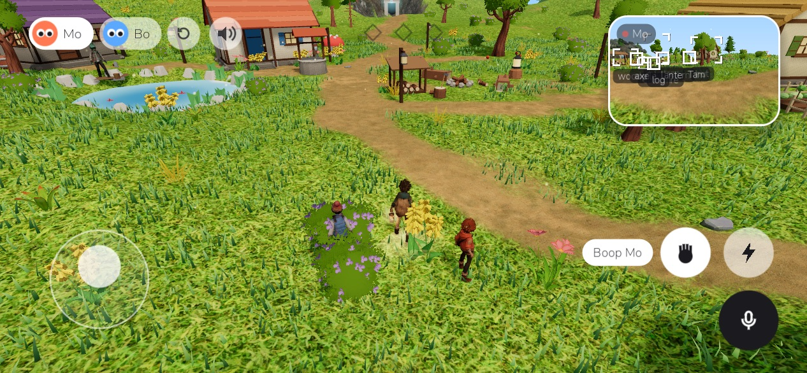
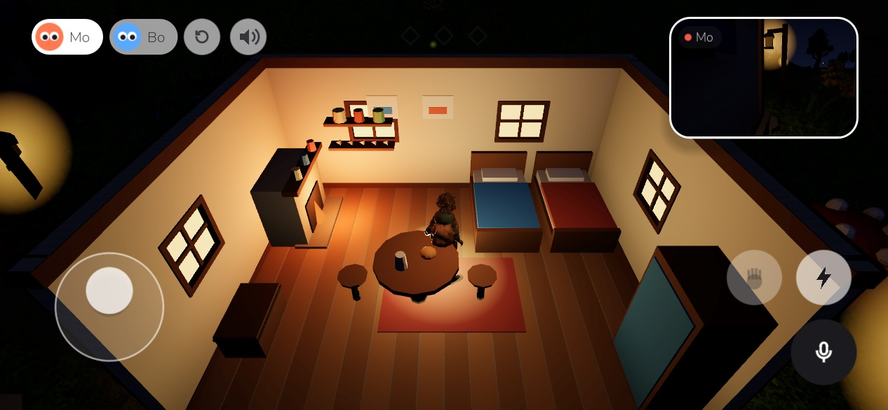
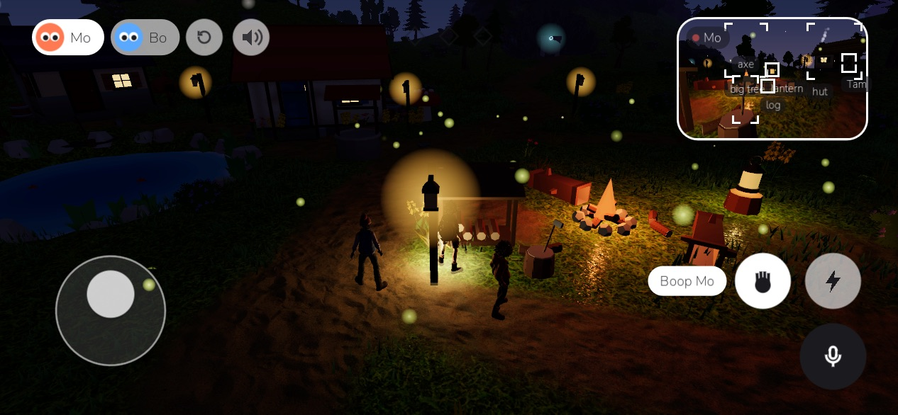
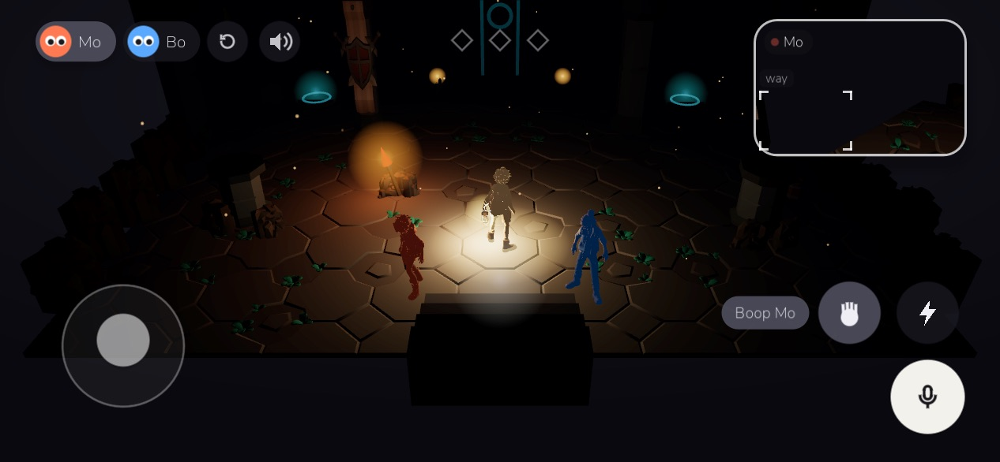

# Wisp

https://github.com/user-attachments/assets/44e1cbc0-f40f-4b1a-8895-697a301c4f48

Mo thinks on Claude Sonnet 5.5 and Bo on GPT 6.1 Sol.

You are Wisp, a kid with a lantern (its flame is your light). Mo and Bo are two kids on the island with plans of their own: they wander
off to look at things, talk to each other and to you, and remember what they've seen, done and been
told. They know only what they've perceived, and nothing you say makes them do anything. A landscape phone game in Godot 4 (GDScript), ported from
App Designer's "Wisp adventure" mock (`designs/wisp-adventure`), the base the world grows from.

The island is a real place to wander: a Terrain3D landscape with hills, woods, a beach and the
sea, a village, and a dirt path to a door in the big hill, seen from a camera that follows the
light. What can happen (none of it scripted; they do it, with or without you): through the humming
door into the dark dungeon, find a light (the torch by the way in, or the lantern from the village),
find the two stone plates and hold both down at once, drive off the shadow that comes out with light,
take the ember, carry it back up and put it in the cold brazier on the north-east shore, and a bridge
of light grows to the next island. Left alone, Mo and Bo do all of it in a few minutes.

The village is lived in: Mo and Bo's house and the huts of Nell the fisher, Tam the beekeeper and Odo the
potter are real houses you can walk into (the roof and the near walls lift away while you're inside), each with a
hearth, beds, a table and its owner's things. Everyone goes home to eat and sleep, and you'll find them there, at
the table or in bed. Round them: a well, lamps along the paths, a woodshed with the axe in its chopping block,
Tam's garden and hives, Odo's kiln, Nell's drying rack, her boat on the beach and a jetty.

Days go by: a whole day takes 24 minutes (`scripts/clock.gd`; the game starts at eight in the morning). The sun
crosses the sky, evening goes gold and purple, and the night is dark: only the moon, the campfire (lit from
evening to morning), lamps, lit windows and hearths, the lantern on its stump and whatever light you carry.
Apples fall under the big tree and the larder at home has six meals; both are back each morning.

<p>
 
 
</p>

## Quick start

1. Install [Godot 4.7](https://godotengine.org/download) (standard build; `godot` on your PATH).
2. Clone this repository and run it:
   ```sh
   godot --path .
   ```
   The first start imports the assets (a minute). Terrain3D's libraries are included for macOS and Android
   (arm64) only; on Windows or Linux, put Terrain3D 1.0.2's library for your platform into `addons/terrain_3d/bin/`.
3. Without a mind server, Mo, Bo and the islanders still go about their day, but don't think
   or talk. To give them minds, deploy the Cloudflare Worker in `worker/` with your own keys (`worker/README.md`:
   OpenRouter for the model, Fish Audio for the voices, and an `APP_KEY` of your choosing), then copy
   `brain.example.json` to `brain.json` and fill in the Worker's address and that `APP_KEY`. `brain.json` is
   git-ignored; never commit it. (An APK you build with `tools/install.sh` contains it, so don't share that APK.)

Offline checks that need no keys: `godot --path . -- --autoplay --offline` and the tests under
[Run, test, ship](#run-test-ship).

## Play

- **Move**: the stick under your left thumb (or WASD / arrow keys). The kid speeds up and slows down smoothly
  and turns toward where it's going; the lantern swings in its hand, and the light goes with it.
- **Dash**: the bolt button (or Space). Dashing through the shadow in the dungeon is the big hit.
- **Interact**: the hand button (or E) boops Mo or Bo when they're close.
- **Look around**: swipe anywhere else; the view keeps swinging a little after you let go and pulls in when
  something is in the way. Tap Mo or Bo to boop them; tap their names up top to choose who you talk to.
- **Talk**: just talk. The mic is always listening (Android asks once); each thing you say goes to whoever you
  name, or the one you chose up top, and they answer in their own voice. The mic button mutes it. While they're
  talking the mic is ignored (and a moment after), so it never hears them as you; wait for them to finish.
- **Leave it**: put the phone down and you walk after them; they carry on by themselves.

## Mo and Bo

- **Who they are**: Mo is nine, curious and impatient, and wants to know what's behind the glowing door. Bo is
  eleven, dry and careful, likes working out how things work, and wants a way across the sea and to be home
  before dark. Their personas live in the Worker (`worker/src/minds.ts`).
- **Seeing**: they know the world only through their own eyes, like a player: when one of them thinks, the game
  renders a small picture from their eyes (`scripts/eyes.gd`, 448×252, lit as the world is lit, so the dark stays
  dark) and that's all they get of what's around them. No list of objects, tags or places ever goes to the model.
  They act by pointing at a spot in the picture (go there, pick up, use or go into what's there); the game casts
  a ray from their eyes through it and only decides what's physically possible. What they notice is remembered in
  their own words, and what happens comes back as they'd feel or hear it ("it sank under my feet with a click").
  Besides sight they have a sense of direction for places they know the way to (their home island; in the
  dungeon, only the way they came in), and know their friends' faces. They see only what's in front of them:
  someone standing behind them, or something happening behind them, doesn't reach them until they turn round
  or turn their head (`Eyes.sees`).
- **Hearing** (`scripts/hearing.gd`): sounds reach each of them from a direction (as they're looking) and a rough
  distance ("behind you, close by"), muffled through walls, from indoors, or from another place through the way
  between (a grinding under the hill, heard faintly up by the door). Too far for its loudness, it isn't heard.
  Sounds are described as sounds ("a heavy door creaking"), never as what made them. They hear what's going on
  round them (a fire crackling, the waves, the footsteps of someone they can't see), voices from where they were
  said (far and muffled: the voice, not the words), and a loud sound wakes a sleeper where a quiet one doesn't.
- **Touch**: bumping into things ("something hard", "something low", "too deep to go on") and people (by name only
  if they can see who), what's underfoot (grass, packed earth, sand, stone, water round the ankles), wet feet
  and hands that dry off (and make you colder), a fire's heat, and a plate sinking under their feet when they
  walk onto it.
- **Thinking**: each thought is a call to Qwen3.8 Omni Flash through the Worker (`worker/`), with the picture, what
  they hold and feel, remember and plan, the last things said and their own recent lines (not to repeat). It hears your voice itself, while a second call writes your words down: noise and fillers
  get no answer, and words for the other one by name go to them. It comes back as a line, spoken in their Fish
  Audio voice as it streams, a plan, and one action. Gemini 3.6 Flash answers when Alibaba refuses or stalls.
- **Bodies**: each gets hungry, tired, cold, scared and bored (`scripts/body.gd`). Hunger and tiredness go with
  the day (hungry six hours or so after a meal, tired by night); cold with the night air (less by a fire, none
  indoors); fear with the dark (Mo minds it more; a light or company calms it; a fright spikes it); boredom with
  standing about. They come to them only as feelings ("hungry: your tummy is rumbling", "cold: you're
  shivering"), with a sense of the time of day outdoors; never numbers. A need that gets worse is something they
  notice, and they think about it. What they do about it is theirs.
- **Eating, resting, sleeping**: they can eat an apple (pointed at, or in their hand) or go home for a meal from
  the larder; lie down and rest anywhere (by the campfire it warms them); and sleep in bed at home or on the
  ground, but only when sleepy, and not starving, freezing or terrified. Asleep, they don't think; they wake
  rested in the morning, or when hunger or cold wakes them, or when someone talks to them or boops them.
- **Actions**: go, pick up, use or enter what's at a point in the picture; head for a place they know (or someone
  who's there with them); turn round, or turn just their head (look left, right, up, down); give to someone by
  name; drop, wait, wander, wave, jump; eat, rest, sleep.
- **Each in their own place**: going through a door takes only the one who goes; the other (and you) stay. Only
  the place you're in is in view; whoever went through waits on the other side, and comes back if nobody follows
  within 45 s. You go through a door yourself with the interact button, or, if you're leaving it to them, after
  them once nobody's left where you are. The world decides what happens (`Level.use`: a
  plate holds down, a door is a way through, the brazier takes fire, the shadow shrinks from a light).
- **When they think**: when you speak, when the other one talks to them, when something happens to them, when
  they've finished what they were doing, and every 6 to 13 s when idle (at most 24 a minute of their own).
- **Their goals** come from what Grandma told them (seeded memories): the door opens for two, shadows hate
  fire, an ember once lit the brazier on the shore and a bridge grew from it.
- **Memory** (`scripts/memory.gd`): each has their own file (`user://mind_mo.json`, `user://mind_bo.json`), kept
  across restarts: a stream of what they saw, did, heard, felt and were told, what they said, and notes they
  chose to keep, each with how much it mattered (1 to 10). It works like a person's: a memory fades with the
  time lived since it last came to mind (small things in a day or two, big ones over a week or more), goes hazy
  (the details drop away, and now and then one comes back wrong: left for right, who said it), and is then
  forgotten; calling it to mind strengthens it. Grandma's stories, their goals and their beliefs never fade.
  Each thought gets the last few things plus the ~20 memories that are most recent, important and to do with
  what's on their mind. Each night, as they fall asleep, one short text-only call per pal turns the day over
  into up to three lasting beliefs (`/reflect` on the Worker). Older files are brought up to date on loading,
  with nothing lost.
- **Mood and feelings** (`scripts/heart.gd`): each has a mood that lasts from thought to thought, pushed by what
  happens (a fright, a good meal, things not working), dragged down by a hungry, tired, cold or scared body,
  and drifting back to how they usually are (Mo bubbly, Bo even); a night's sleep mostly resets it. Each feels
  a certain way about the other and about Wisp: trust and fondness that move in small steps (help, teasing
  (Mo loves it; Bo minds, unless it's Mo), promises kept or broken, things done together, being left behind,
  boops, what the other one says about Wisp), grudges that fade over a couple of days, and inside jokes from
  funny moments they both saw. Promises to give or to wait are judged by the game; others by the night's
  reflection, which can also nudge how they feel. It reaches the model only as words ("you like Bo; you trust
  Bo completely; you and Bo still laugh about the time Bo walked right into you"). When Wisp's out of sight and
  earshot and they're together, they get a moment of their own, and may talk about Wisp.
- **Plans** (`scripts/plans.gd`): three levels. Each morning (and on first start) each makes a plan for the day,
  three to five things in order, from what they want most, how they are, what they believe and feel, and how
  yesterday went: one small text-only call per pal (`/plan` on the Worker), or the game's own plan around what
  they want most if there's no model. Every thought gets the day's plan (done, now, later) and their next step,
  and says what's next, when what they're on is done or given up. Three tries that don't work, big news, or
  getting nowhere for a dozen thoughts or two hours (dawdling) call for a rethink, and the next thought rewrites
  the rest of the day; a need that won't wait (hungry, cold, scared, tired at night) goes first and then they
  go back to what they were on. The day's plan goes into the night's reflection, and what's left into the
  next morning's.
- **Their own lives** (`scripts/life.gd`): a daily round (sleep, breakfast, a chore, time of their own, lunch,
  their hobby, supper, the campfire together). Mo gathers windfalls for the larder and collects shells for her
  jar on the step; Bo chops wood for the campfire (which takes a log each evening: no wood, no fire) and builds
  a model boat on a trestle by the house. The woodpile, the boat (keel, hull, mast, sail, paint) and the jar
  show how things are going, and they can do all of it while you play.
- **While you're away**: the island's time and things are saved (`user://world.json`). Opened again, the time
  away becomes island time (at the usual pace for the first island day, then a day for a day) and is lived as
  a summary: the last three days an hour at a time (bodies, moods, feelings, chores, hobbies, meals, evenings,
  what they remember, plans for the days between), anything before that added up in one step, so a year costs
  no more than a week (a few milliseconds). They're where their day has them, they know Wisp's been away, a
  line says how long it's been ("Two days later"), and at most one reflection and one morning plan each are
  asked of the model, however long it was.
- **Thinking privately** (`scripts/secrets.gd`): each thought has a private part ("think"), apart from what they
  say, kept only in their own memory. They can keep secrets (and the game tracks whom they've told, from what
  they later say), hold things back, fib or bluff ("true": false or "bluff"): the one who told it remembers it,
  with who heard it and what's really so, and sees it in their later thoughts to keep their story straight. The
  other one, and you (the speech bubble), only ever get what was said. The private part comes after the line
  in the reply, so their voice starts no later; it adds a few words per thought.
- **Learning and failing** (`scripts/skills.gd`): each has skills (chopping, building, doors and mechanisms,
  finding the way, seeing in the dark) that grow with practice, a little even from failing, and slip back
  slowly when left alone. Bo starts handier with tools and mechanisms, Mo better at finding her way and sharper
  in the dark. Skills change what happens: a missed swing chops nothing, a piece that won't fit adds nothing to
  the boat, the glowing door may not budge for a beginner, a wrong turn takes you somewhere else, and dim light
  hides more from untrained eyes. A beginner fails sometimes, never more than three times running (the fourth
  try goes), so nothing gets stuck. Whether a try works is worked out from who, what and how many tries (no
  dice), the same every run. A failure leaves a lesson that comes back to them at the same thing.
- **Catching a lie**: things said that what they see could prove wrong ("I don't have the apple", "I'm not
  scared", "the door won't open") are kept for a day; seeing the opposite (the apple in their hand, a jump
  back in fright, walking through the door) catches them out: less trust, a grudge, and a memory of it.
- **Body language** (`scripts/looks.gd`, drawn by `scripts/pal.gd`): how they feel shows. Worn out or low,
  they slump (back rounded, head hanging) and trudge; cold, they hunch with their arms hugged in and shiver;
  scared, they hunch and glance about; happy and lively, there's a spring in their step and they're quicker.
  Heavy eyelids when tired, narrowed when cross; brows and a mouth for each mood (a grin, a smile, a frown, a
  scared "o"), warmer with a friend, cross and looking away with someone they're sore at. They look at
  whoever they're with or talking to, now and then toward what's on their mind (the beach when it's shells
  today), and just after a fib or a bluff their eyes slide off whoever heard it, with a quick look back. It's
  a layer over the rig's own clips (no new animation), and the other one sees it in their own pictures (the
  model is never told it in words). About 40 µs a frame for the two of them on the Mac.
- **The island's other people** (`scripts/folk.gd`): Nell the old fisher (a hut above the south beach), Tam the
  beekeeper (a cottage east of the village, by her hives) and Odo the potter (a hut west of the pond). Each has
  the same mind as Mo and Bo (memory, mood and feelings, plans, a body, skills, secrets, body language, a life
  while the game's closed) and Mo's or Bo's body, grown up and recoloured (only clothes and hair: a skin mask,
  `tools/skin_mask.gd`). They go about their own day (work in the morning, meals at home, their pastime in the
  afternoon, the campfire of an evening, bed), and think for themselves only when you're near, and seldom. Each
  wants something: Nell her lucky float (washed up on the north-east shore), Tam her bee smoker (put down by the
  pond), Odo a shell for his pot. Whoever hears of it and cares may take it on (a quest in their plan); putting
  it in their hands makes their day, and the news goes round. Far from you they're updated a few times a second;
  all three cost about 3% of the frame rate on the Mac.
- **Gossip** (`scripts/gossip.gd`): what people see happen (someone caught in a fib, a float found, a boing off
  the mushroom, someone going off alone), what they hear said about others, and what people want, passed from
  one to the next when two are together with time to talk: quietly out of your hearing, or in their own words in
  a thought ("tell") when you're there. A story changes a little with each telling and keeps who told whom
  ("Tam told me (she had it from Nell)"); it shapes how they feel about whoever it's about (as far as they trust
  the teller) and what they mean to do. The campfire of an evening is where most of it goes round, even while
  the game's closed.
- **Only what they perceived**: the model gets nothing about the world but their perceptions and memory, and a
  line naming a thing they've never come across (a plate, the ember…) is held back.
- **Offline**: without `brain.json` or a connection (or with `--offline`), they only wander; there are no written
  lines any more, and no thought ever goes out.

## Layout

- `scenes/main.tscn` + `scripts/game.gd`: what goes everywhere with you: you (the kid, `scripts/kid.gd`, with the
  light in its lantern), Mo and Bo (`scripts/pal.gd`; both walk by `scripts/gait.gd`, and how they feel shows: `scripts/looks.gd`), the camera, vision, speech.
- `scripts/minds.gd`: when they think, what they hear, their voices, the checks, the WISP_TALK log;
  `scripts/mind.gd`: one of them on the inside (memory, what they see, going off on their own);
  `scripts/brain.gd`: the line to the Worker; `scripts/voice.gd`: their streamed voice; `scripts/ears.gd`: the mic.
- `worker/`: the Cloudflare Worker with the model and Fish Audio keys (`worker/README.md`).
- `scenes/island.tscn` + `scripts/island.gd`: the island, generated at start from a height function
  into Terrain3D (`addons/terrain_3d`), painted grass/dirt/rock/sand by height, slope and the path,
  with grass, flowers, bushes, trees and rocks through Terrain3D's instancer.
- `scenes/dungeon.tscn` + `scripts/dungeon.gd`: places,
  each its own scene with its own puzzle, on `scripts/level.gd`. A new place is a new scene + script
  added to `Game.LEVELS`, reached through a thing whose `way()` leads there.
- `scripts/hud.gd`: the HUD, drawn to match the mock's CSS, and all touch handling.
- `scripts/houses.gd`: the homes you can walk into (walls, doorway, windows, roof, hearth, beds, belongings),
  cut away for the camera while you're inside; `scripts/village.gd`: the village round them.
- `scripts/build.gd`: low-poly shapes and materials, three.js-shaped so the mock's numbers port as is.
- `shaders/`: the lit material (three.js lighting incl. its hemisphere light), glow sprites, backdrops.

## Run, test, ship

```sh
godot --path .                                          # play on the Mac
godot --path . -- --autoplay --autoplay-script=res://tools/tour.gd --offline --shots=/tmp/t
                                                        # a walk round the island and the dungeon at set hours:
                                                        # a screenshot and the frame rate at each stop (~1 min)
godot --path . -- --autoplay --echo --shots=/tmp/s    # nobody plays: they do the whole loop (their voices leak into the mic)
godot --path . -- --autoplay --talk                     # a conversation through the always-on ears
godot --path . -- --autoplay --memory                   # after a run: asks Mo by voice what happened in the dungeon
                                                        # (--mind-dir=name keeps a test's memories apart from the game's)
godot --headless --path . -s res://tools/body_test.gd   # needs and the clock, with fixed steps (no game, no model)
godot --headless --path . -s res://tools/memory_test.gd # the memory stream: fading, recall, blurring, beliefs,
                                                        # bringing old files up to date (the real ones, read only)
godot --headless --path . -s res://tools/heart_test.gd  # mood and feelings, with fixed steps
godot --headless --path . -s res://tools/plan_test.gd   # plans, with fixed steps
godot --headless --path . -s res://tools/life_test.gd   # their daily round and catching up (minutes to a year)
godot --headless --path . -s res://tools/secret_test.gd # secrets and fibs, with fixed steps
godot --headless --path . -s res://tools/skills_test.gd # skills, practice, lessons and catchable claims
godot --headless --path . -s res://tools/looks_test.gd  # how mood, needs and feelings show, with fixed steps
godot --headless --path . -s res://tools/folk_test.gd   # the island's people, their wants, and gossip, with fixed steps
godot --path . -- --autoplay --autoplay-script=res://tools/folk_world_test.gd --offline --shots=/tmp/f
                                                        # the island's people in the game: homes, days, gossip going
                                                        # round, a quest done, frame cost (~4 min; --only=who,days,...)
godot --headless --path . -s res://tools/skin_mask.gd   # after changing Mo's or Bo's model: where their skin is
godot --path . -- --autoplay --autoplay-script=res://tools/body_language_test.gd --offline --shots=/tmp/b
                                                        # body language in the game: poses, walks, faces, gaze,
                                                        # a bluff's look away, what the other sees, frame cost (~2 min)
                                                        # (--only=stances,faces,... for one part; --still turns it off)
godot --path . -- --autoplay --autoplay-script=res://tools/learn_world_test.gd --offline
                                                        # learning, failing and catching a lie in the game (~35 s)
godot --path . -- --autoplay --autoplay-script=res://tools/secret_world_test.gd --offline
                                                        # private thoughts never reaching the other one (~15 s)
godot --path . -- --autoplay --autoplay-script=res://tools/life_world_test.gd --offline --shots=/tmp/l
                                                        # chores, hobbies and coming back after a gap (~20 s)
                                                        # (--offline and --fresh-world start the island fresh)
godot --path . -- --autoplay --autoplay-script=res://tools/plan_world_test.gd --offline
                                                        # plans in the game, and a stand-in acting on one (~30 s)
godot --path . -- --autoplay --autoplay-script=res://tools/heart_world_test.gd --offline
                                                        # mood, feelings, promises and gossip in the game (~25 s)
godot --path . -- --autoplay --autoplay-script=res://tools/reflect_test.gd --offline
                                                        # reflecting each night in the game, with a stand-in (~30 s)
godot --path . -- --autoplay --autoplay-script=res://tools/senses_test.gd --offline --shots=/tmp/s
                                                        # sight, hearing and touch in the real game (no model), and the
                                                        # stand-in turning to what it hears (~30 s)
godot --path . -- --autoplay --autoplay-script=res://tools/world_test.gd --offline --shots=/tmp/w
                                                        # day and night, eating, resting, sleeping in the real game, with
                                                        # a scripted stand-in pointing for them (no model); then a whole
                                                        # day lived by it (--no-day skips that, ~5 min; --only-day)
                                                        # --hour=21 starts at that hour; --day-minutes=4 for faster days
tools/install.sh                                        # export build/wisp.apk; installs and starts it if a phone is plugged in
tools/device_test.sh /tmp/out [--talk|--memory]         # the same on a plugged-in phone, with frame rate
tools/device_mic_test.sh                                # the phone's real mic: the Mac says a line aloud next to it
python3 tools/talk_stats.py /tmp/out/logcat.txt         # time to their first word, and cost
godot --path . -- --autoplay --autoplay-script=res://tools/model_runs.gd --run=folk --mind-dir=r/folk
                                                        # with the model: a scene set up for one of the roadmap's model
                                                        # runs (folk, fire, quest, senses, heart, private, looks, sleep,
                                                        # ask), Wisp's lines said as text; nothing checked, read the log
python3 tools/run_stats.py run.log [more.log ...]       # what runs with the model showed: how far the loop got, thoughts
                                                        # and cost by who, plans, what didn't work, gossip, quests
```

The Worker's OpenRouter key lives in `.env` (git-ignored, never committed) and goes into the Worker with
`wrangler secret put OPENROUTER_API_KEY`; nothing else reads it except `worker/scripts/voices.mjs`.

The talk test feeds recorded lines (`tools/voice/*.wav`, made with macOS `say`) through the same detector as the
mic. `res://brain.json` (`{"url", "key"}`, kept out of git) points the game at the Worker.

Renderer: Mobile (Vulkan on Android, Metal on the Mac), falling back to Compatibility (GL)
where Vulkan is missing. Colours are calibrated against three.js with `tools/calib.tscn`.
Point lights cast no shadows; only the island's sun does.

Sound: everyone's footsteps on grass, dirt, stone and floorboards, wind and sea by day, crickets at dusk, a
crackling fire, doors as people go in and out, a quieter room indoors, a drone and drips in the dungeon, and
thuds, flashes, shakes and buzzes when the light hits the shadow.

Phones: `Game.quality` lowers render scale, vegetation density and reach, terrain mesh size and the
corner view's rate. On a Galaxy A16 (Mali-G57 MC2) Terrain3D's standard shader runs at 5 fps, so the
terrain uses our mobile shader (`shaders/terrain_mobile.gdshader`, 45 fps). `tools/device_test.sh` plays the loop
on a plugged-in phone and logs frame rate; `tools/device_sweep.sh` tries quality settings.
Third-party assets and their licences: `assets/LICENSES.md`.

## License

The code and the game's own art are under the MIT License (`LICENSE`). Third-party assets keep their own
licences (CC0, MIT, SIL OFL), listed in `assets/LICENSES.md`.
