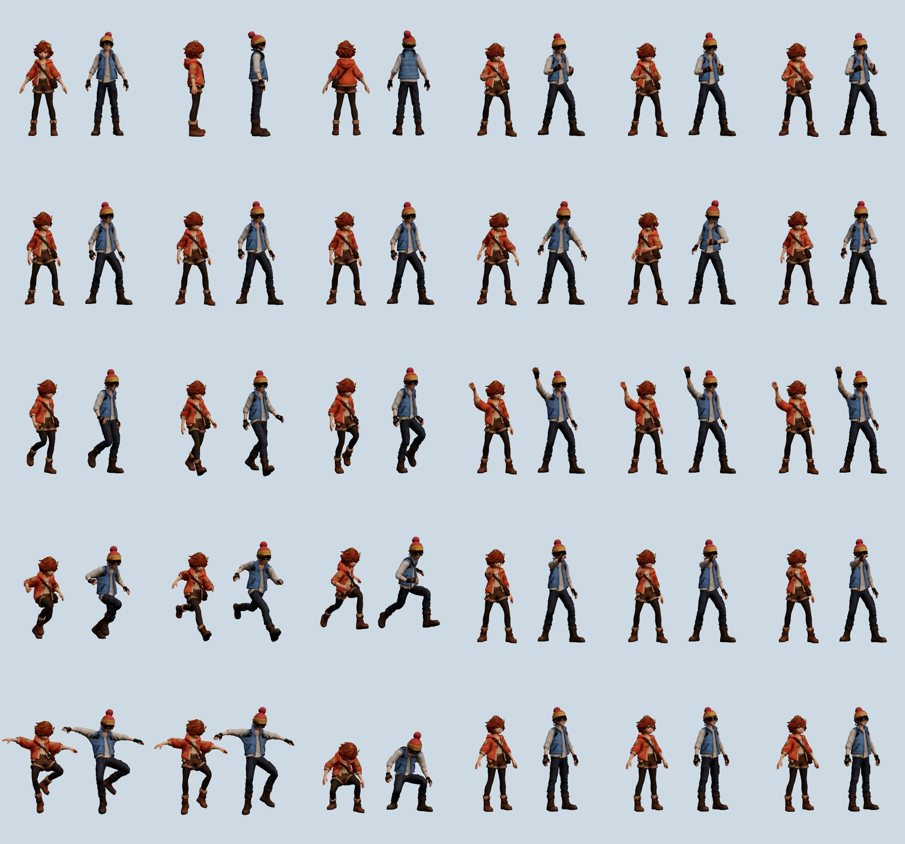

# Mo and Bo

The two pals, as kids, made from Codex's pictures (`refs3d/mo-human.png`, `refs3d/bo-human.png`).
Tencent Hunyuan3D-2.1 made the shapes and painted them on a rented GPU (an RTX A5000). Blender then put each
picture's own face on, gave them eyelids, the Universal Animation Library's skeleton and its clips.
`scripts/pal.gd` plays them.

| File | Shape | Triangles | Bones | Texture | Size |
| --- | --- | ---: | ---: | --- | ---: |
| `mo.glb` | seed 1234 of 1234, 7, 42 | 11,100 | 23 | 2048² (ETC2 on Android) | 1.6 MB |
| `bo.glb` | seed 7 of 1234, 7, 42 | 11,100 | 23 | 2048² (ETC2 on Android) | 1.6 MB |

- **Picking:**
  - **Shapes:** three seeds each, scored by how well the front silhouette covers the picture's
    (`docs/*-candidates.jpg`).
    - **Mo:** 0.894, 0.896 and 0.902.
    - **Bo:** 0.871, 0.878 and 0.887.
  - **Paint:** the best two of each were painted, faced and rigged, then compared close up in Godot
    (`docs/*-faces.jpg`).
    - **Mo:** seed 1234 (both eyes clear, the round face) over 42.
    - **Bo:** seed 7 over 42 (which had a seam in the hair).
- **Placement:** Y is up (glTF). Each one stands on y = 0, centred under the hips, and faces +Z. Mo is 1.35
  tall and Bo 1.48 with the pom-pom.
- **Face:** Hunyuan3D-2.1 paints the figure from eight views at 768, too small for a face, which comes out
  smudged. The picture's own face is projected onto the paint from the front instead.
  - **Fitting it:** `facefit.py` finds where the picture's face fits the painted one (scale 0.92 to 1.08).
  - **Writing it:** `face.py` writes it into the texture, kept within 10% of the picture's brightness.
- **Eyelids:** a skin-coloured patch over each eye, shaped to the face, with a dark lash line at its lower
  edge, on its own bone (`lid.L`, `lid.R`). The blink clip's first and last frames squeeze the lids flat
  inside the head (eyes open); its middle lets them down. The game holds the first frame between blinks.
- **Skeleton:** the [Universal Animation Library](https://quaternius.com/packs/universalanimationlibrary.html)'s
  (Quaternius, CC0), without the fingers, plus the two lids. The joints were picked on the pictures
  (`pipeline/*-keypoints.json`) and set as deep in the mesh as the middle of the limb or body there. The
  weights come from bone heat, each limb kept to what is close round it (not the bag or the vest).
- **Clips** (30 fps):

  | Clip | From the library | Length | Notes |
  | --- | --- | ---: | --- |
  | `idle` | Idle_Loop | 2.5 s | |
  | `walk` | Walk_Loop | 1.33 s | |
  | `run` | Jog_Fwd_Loop | 0.93 s | |
  | `jump` | the second half of Jump_Start, then Jump_Land up to the recovery | 1.4 s | |
  | `talk` | Idle_Talking_Loop | 2.93 s | |
  | `pick_up` | PickUp_Table | 0.83 s | |
  | `wave` | Idle_Loop | 2.0 s | made here |
  | `point` | Idle_Loop | 1.6 s | made here |
  | `blink` | | 0.2 s | the eyelids only |

  - **Wave and point:** neither CC0 library (UAL 1 or 2) has them, so they're made here, on the same
    skeleton: the idle, with the right arm raised and waving over the head, or held straight out in front.
  - **Retargeting:** each bone turns in the world as the library's does, counted from an A pose like theirs.
- **In the game** (`scripts/pal.gd`):
  - **Going** (`scripts/gait.gd`, shared with the player's kid in `art/player`):
    - **By speed:** standing, walk, jog and run blend into each other, each step clip played by the
      distance covered at its own stride, all in step (the left foot lands at the same point of each
      cycle).
    - **The jog and the run:** made from the library's Jog_Fwd_Loop, which bounds six hip heights a
      second (a sprint): the limbs swing 35% (jog) and 70% (run) of its way about their middle, the knees
      bending more than that, the hips moved so the foot that's down stays on the ground, the bounds
      lowered as much. Natural paces, Mo: walk 0.81, jog 2.44, run 4.09 m/s.
    - **Feet:** a foot that's down (the ball of it on the ground) is held where it landed, the leg
      reaching it by two-bone IK, while they're going.
    - **Easing:** they speed up at 4.5 m/s² and slow down at 5 to stop where they're going, lean into
      turns (as much as the turn pulls, against gravity), forward into speeding up and back into slowing.
    - **The bench:** `godot --path . -s res://tools/gait_test.gd -- mo bo player` runs each through
      the same course and measures how fast the planted foot slides (`--old` for the clips played as
      before; `--shots=DIR` for frames).
  - **Body clips:** talk while talking, idle otherwise.
  - **Gestures:** jump on a bounce, pick_up when crouching for something, wave on being chosen, and point at
    what they've just spotted.
  - **Eyelids:** a second player blinks them now and then.
  - **Head:** a skeleton modifier turns it, and a little of the neck, toward what they're looking at.
- **Import:** LODs are off (`*.glb.import`): automatic LODs would flatten the face and the eyelids. The
  extracted textures (`*_textured-face.jpg`) import VRAM-compressed.
- **Licence:**
  - **Shapes and paint:** made with [Tencent Hunyuan3D-2.1](https://github.com/Tencent-Hunyuan/Hunyuan3D-2.1)
    under the Tencent Hunyuan 3D 2.1 Community License, which claims no rights in what it generates (that
    licence does not cover the EU, the UK or South Korea).
  - **Skeleton and clips:** Quaternius's Universal Animation Library, CC0.

## Remaking them

`pipeline/` (ignored by Godot) has the scripts, adapted from Hidden Hearths' traveller.

**On the GPU machine** (`pytorch/pytorch:2.5.1-cuda12.4-cudnn9-devel`; the pictures in `~/job/in`):

- `setup.sh`: Hunyuan3D-2.1 and its weights, about 10 minutes on a host with good bandwidth. It retries the
  downloads: some hosts drop them.
- `gen.py shape NAME SEED...`: the shapes, about 2 minutes each.
- `gen.py paint NAME SEED...`: their paint, about 2.5 minutes each. The VAE decodes one view at a time; all
  at once ran out of a 24 GB card's memory.

**On the Mac**, with Blender as a Python module (`python3.11 -m venv v && v/bin/pip install bpy==4.4.0
"numpy<2" pillow scipy`):

- `shapes.py OUT.png NAME-rgba.png *.obj`: the candidates lined up, scored.
- `build.sh NAME DIR HEIGHT OUT.glb`: for a painted candidate in DIR, the face (`front.py`, `facefit.py`,
  `face.py`) and the rig (`rig.py`, about 20 s). It needs these set:
  - `PY`: that Python;
  - `PIC`: the picture;
  - `BOX`: its cut-out's box, `[x0, y0, x1, y1]` of `NAME-rgba.png`'s alpha;
  - `UAL`: the library's `Godot/AnimationLibrary_Godot_Standard.glb`, from
    https://opengameart.org/content/universal-animation-library.
- `project.py`: a stand-in for the paint (the picture projected from the front), for trying the rig before
  the paint is done.
- TRELLIS.2 (tried for the player's kid, `art/player`): `setup_trellis.sh` and `trellis.py NAME TYPE
  SEED...` on the machine, `glb2obj.py IN.glb DIR` on the Mac.

The toy pals (round bodies with a sprout and a party hat) were made the same way before. Their models and
scripts are in this folder's history, up to commit 5457d4f.
